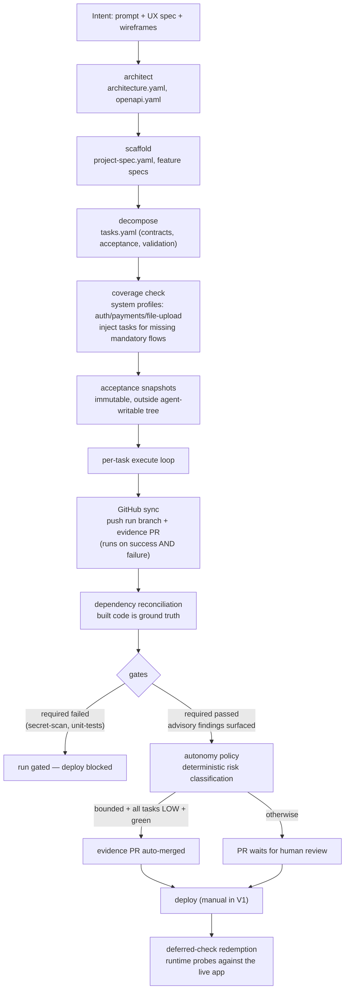
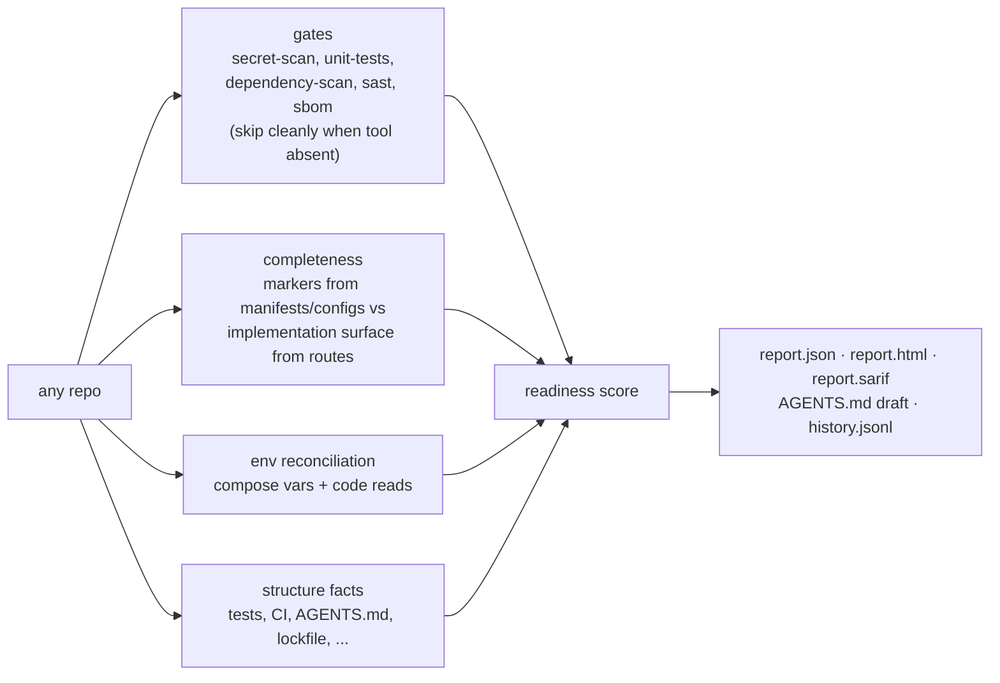

# Genesis Architecture

_How the pieces fit: packages, pipeline, audit, contracts, trust model, and
what is deliberately not solved yet._

Genesis is two things that share one governance core:

1. **A build platform** (commercial): prompt → UX plan → wireframes → a
   pipeline that plans, decomposes, executes with a pluggable coding agent,
   and gates the result before deploy.
2. **A standalone audit/validation framework** (open source): `genesis adopt`
   scores any repository's agent-readiness with zero API keys, and the gate
   engine turns a delivery manifest into an evidence package in CI.

Both consume the same deterministic analysis layer in `genesis-gates`. The
split is documented in [open-core.md](open-core.md); the dependency arrow only
ever points commercial → OSS, enforced by
`packages/genesis-gates/tests/test_oss_boundary.py`.

## Five layers → actual code

The product model is five layers (see `pm/strategy-roadmap.md`). Each maps to
concrete modules — nothing below is aspirational; paths are where the code
lives today.

| Layer | What it does | Where it lives |
|---|---|---|
| 1 · Interaction | Any coding agent on top; interchangeable | `genesis-executor/adapters/` — `ClaudeCliAdapter` (subscription CLI), `ClaudeSdkAdapter` (API key), `OpenRouterLoopAdapter` (tool loop). `genesis-cli` for terminal use; `frontend/` for the dashboard |
| 2 · Task / Agent | requirement → plan → tasks → PR → review | `genesis-server/services/pipeline/`: `stages/` (architect, scaffold, decompose), `orchestrator.py`, `task_git.py` (per-task commits), `github_sync.py` (evidence PRs), `task_board.py` |
| 3 · Architecture | Opinionated blueprints and standards | `gss/` blueprints, `skills/` registry, system profiles (`genesis-gates/src/genesis_gates/analysis/completeness.py` + pipeline adapter `system_profiles.py`), `manifest.py` (delivery manifest builder) |
| 4 · Validation | Every output gated | `genesis-gates`: `engine/` (runner, registries), `gates/` (secret-scan, unit-tests, dependency-scan, sast, sbom, container-scan, risk-classify), `providers/` (gitleaks, trivy, semgrep, syft, pip-audit, pytest, BYO command/report/external), `analysis/` (completeness, reconciliation, readiness, risk). Per-task acceptance: `genesis-executor/validation.py`; runtime redemption: `genesis-server/.../deferred_checks.py` |
| 5 · Governance | Evidence, cost, approvals as a record | Evidence table + cost ledger + gate panel (`genesis-server`, `frontend/`), evidence PR bodies + risk comments (`github_sync.py`), immutable acceptance store (`acceptance_store.py`) |

## The build pipeline

The orchestrator (`genesis-server/services/pipeline/orchestrator.py`) runs the
whole flow as one resumable asyncio job. Every stage writes its artifact into
the workspace's `.genesis-work/`, and resume skips any stage whose artifact
already exists; the execute stage resumes per-task via `tasks-state.json`.



Stage notes, in order:

- **Planning stages** (`architect`, `scaffold`, `decompose`) call an LLM
  through the `ModelProvider` abstraction with structured outputs, retries on
  transient provider errors, and a per-call cost ledger. Change requests skip
  planning entirely: the request is decomposed into a new task batch appended
  to `tasks.yaml`; existing tasks are never mutated.
- **Coverage check** (`system_profiles.py` over the shared
  `analysis/completeness.py`): system markers in the planning artifacts
  (e.g. Keycloak/JWT) activate a profile whose mandatory flows must appear in
  the *implementation surface* — routes, contract paths, task titles — never
  prose. A gap becomes an injected task, generated by the LLM grounded in the
  existing OpenAPI contract, with a deterministic fallback task if generation
  fails. Idempotent: full coverage means zero LLM calls.
- **Acceptance snapshots** (`acceptance_store.py`): each task's `validation`
  list is written first-write-wins with a sha256 to
  `workspaces/.acceptance/{project}/`, outside the agent-writable workspace.
  The executor validates against the snapshot, so an agent that edits
  `tasks.yaml` cannot weaken its own acceptance criteria.
- **Per-task execution** (`genesis-executor/runner.py`): the adapter runs
  inside a path-confined sandbox (argv-only, no shell, scrubbed env); then
  fail-closed validation — `file_exists` / `file_contains` / `command` checks
  where any error or unknown check type is a failure, and a task with zero
  checks does not pass. Failing checks feed a bounded repair loop (max 2
  rounds). Runtime checks (`api_endpoint_responds`) are recorded as
  **deferred** — neither pass nor fail — because they cannot be verified for
  one task in isolation. Each task then lands as a trailer-tagged git commit
  (`task_git.py`), giving it a durable, diffable identity.
- **GitHub sync** (`github_sync.py`): the run branch
  (`genesis/run-<id>`) is pushed and a PR opened whose body is the evidence —
  a per-task table of status, checks, repair rounds, cost, and commit, with
  expandable acceptance criteria and failing checks. Degrades gracefully: no
  config or token means the run stays local-only.
- **Dependency reconciliation** (`analysis/dependency_reconcile.py`): the
  built app's compose `${VAR}` contract and direct env reads are diffed
  against the stored dependency map; anything planning-time detection missed
  is registered before deploy. (Live-observed failure this prevents:
  detection said `OPENAI_API_KEY`, the built app read `OPENROUTER_API_KEY`,
  deploy shipped an empty key.)
- **Gates** (`gates_stage.py` + the `genesis-gates` engine): the delivery
  manifest splits gates into `validation.required` — **fail-closed**, a
  non-pass blocks deploy — and `validation.advisory` — run and surfaced, never
  blocking. Default policy: `secret-scan` and `unit-tests` are required (they
  assert *this change* is safe); `dependency-scan`, `sast`, `container-scan`,
  `sbom` are advisory (they largely report pre-existing ecosystem risk and
  feed triage). Results are persisted as an Evidence Package.
- **Autonomy policy** (`finalize_run` in `github_sync.py` +
  `analysis/risk.py`): every task is risk-classified deterministically from
  its own declared content — auth, payments, migrations, secrets, infra, and
  customer data are always HIGH; docs/tests/lint are LOW; everything else
  MEDIUM, with the markers that produced the classification attached. The
  classification is posted as a PR comment. Auto-merge happens only when
  *every* condition holds: project autonomy is `bounded` (default is
  `supervised`), all required gates passed, every task passed, and every task
  is LOW. Anything else leaves the PR open with the reasons stated.
- **Deploy + redemption** (`deferred_checks.py`): deploy is a manual action in
  V1. When a deploy is running, every deferred check is redeemed against the
  live app under honest rules: a response `< 500` and `!= 404` proves the
  route exists (401/403/422 count); 404, 5xx, and connection errors fail;
  checks that cannot be mapped onto the running stack are reported
  `unverifiable`, never silently passed. Failures are surfaced and persisted
  but do not tear the deploy down.

## The audit flow (`genesis adopt`)

The CLI runs the same validation core against any repository, brownfield
included, with no Genesis artifacts present. Deterministic by construction:
no API keys, no server, no LLM (the LLM-consulting `risk-classify` gate is
excluded on purpose).



Scoring (`analysis/readiness.py`) is weighted with receipts per category:

| Category | Weight | What it measures |
|---|---|---|
| validation | 40 | Gate outcomes (unit-tests and secret-scan weighted heaviest; skipped earns partial credit — not run is better than failed, worse than green) |
| structure | 30 | Agent-readiness facts: tests, CI, AGENTS.md, lockfile, `.env.example`, README, containerization |
| completeness | 20 | Mandatory system flows implemented (no "signup without sign-in"); full credit when no profile is detected |
| env_hygiene | 10 | Deploy env contract matches what the code actually reads |

Grades: A ≥ 90, B ≥ 80, C ≥ 70, D ≥ 55, else F. Default exit code mirrors the
grade (A–C → 0, D/F → 1); CI mode adds `--min-score` and
`--baseline`/`--fail-on-regression` (score drop > 0.5, a new mandatory-flow
gap, or a new critical/high finding). Every audit appends one line to
`history.jsonl`, making the score a time series with no infrastructure.

Companion commands: `genesis gates` runs just the gate set as a per-gate
table; `genesis init` scaffolds a bare repo agent-ready (AGENTS.md from a real
audit, `.gitignore`, `.env.example`, audit workflow, gate config — idempotent,
never overwrites); `genesis adopt --review` adds the AI second-reader (below).

## Artifact contracts

The JSON Schemas in `packages/genesis-gates/contracts/` are the compatibility
surface between the open core and everything built on it — additive-only
within a major version. Commercial code consumes artifacts through these
schemas, so core evolution cannot silently break the platform.

| Schema | Contract |
|---|---|
| [`manifest.schema.json`](../packages/genesis-gates/contracts/manifest.schema.json) | Delivery Manifest — the sealed "what" an AI-assisted change must produce: change identity/source, service criticality and data classification, required vs advisory gates, release strategy |
| [`evidence.schema.json`](../packages/genesis-gates/contracts/evidence.schema.json) | Evidence Package — what a manifest run produces: per-gate results, findings with severity/location/remediation, overall pass/fail/error |
| [`task.schema.json`](../packages/genesis-gates/contracts/task.schema.json) | Task — the unit of reviewable execution: acceptance criteria and flows, API contracts, file specs, validation rules, batch grouping. Deliberately permissive (`additionalProperties: true`) so newer producers stay readable by older consumers |
| [`readiness-report.schema.json`](../packages/genesis-gates/contracts/readiness-report.schema.json) | Readiness Report — the `genesis adopt` output: score/grade/categories, gate results, completeness gaps, env reconciliation, structure facts |
| [`gateconfig.schema.json`](../packages/genesis-gates/contracts/gateconfig.schema.json) | Gate Config — the per-repo "how": provider selection, severity thresholds, timeouts, BYO command/report/external providers |

## Extending Genesis

There are two extension surfaces, and the split matters: a **gate** declares
*what* must be checked (`secret-scan`) and owns the policy; a **provider** is
one concrete *how* to produce that check's findings (gitleaks, or a BYO
`command`/`report`/`external`). Adding a scanner is usually a provider, not a
gate.

```python
# my_plugin/gates/license_check.py
from genesis_gates import Gate, register_gate

@register_gate
class LicenseCheckGate(Gate):
    name = "license-check"                 # unique; matches the manifest vocabulary
    description = "Flag disallowed dependency licenses."
    providers = ["my-license-scanner"]     # ordered built-in provider keys

# my_plugin/providers/my_license_scanner.py
from shutil import which

from genesis_gates import GateResult, GateStatus, Provider, register_provider

@register_provider
class MyLicenseScanner(Provider):
    key = "my-license-scanner"

    def is_available(self, ctx) -> bool:   # self-skip when the tool is absent
        return which("licensed") is not None

    def run(self, ctx) -> GateResult:
        ...                                # -> passed / failed / skipped / error
```

Inside this repo, dropping the module into `genesis_gates/gates/` or
`genesis_gates/providers/` is enough — both packages auto-import their own
modules at import time, so the decorator runs. **You do not need to fork the
repo to add either one.** Any installed distribution can contribute through
entry points:

```toml
# your-plugin/pyproject.toml
[project.entry-points."genesis_gates.gates"]
license-check = "my_plugin.gates.license_check:LicenseCheckGate"

[project.entry-points."genesis_gates.providers"]
my-license-scanner = "my_plugin.providers.my_license_scanner:MyLicenseScanner"
```

`pip install my-plugin` next to Genesis is the whole install step; the gate then
appears in `genesis gates`, in `.genesis/config.yaml`, and in a manifest's
`validation.required`/`advisory` lists like any built-in.

**The discovery contract** (`genesis_gates/_plugins.py`):

- An entry point may resolve to a `Gate`/`Provider` **subclass** (registered
  under its `name`/`key`) or to a module that registers on import via the
  decorators. An entry point that loads but registers nothing is reported, not
  ignored.
- **Fail-soft, but visible.** A plugin that raises on load never breaks the CLI;
  the failure is collected in `genesis_gates.plugin_errors` and surfaced by the
  commands that use the registry ("1 plugin failed to load: name — reason").
  Nothing is silently swallowed.
- **Built-ins win — registration is append-only.** Plugins load *after* the
  built-ins, and a plugin may add names but never take over one already
  registered; attempted replacements (including via import side effects) are
  reverted and recorded as conflicts. This is a governance property, not a
  namespacing convenience: an installed third-party package must not be able to
  re-register `secret-scan` as a no-op and quietly weaken every audit on the
  machine. Extend the check set; do not redefine it.

**The contract a gate must honour** — the same rules the built-ins follow, and
what review looks for:

- **Deterministic.** Same repo in, same result out; no network calls in
  analysis, no wall-clock or ordering dependence. The audit is a trust anchor
  only if it is reproducible.
- **Fail-closed on the gate's own errors.** A crash is `error`, never `passed`.
  A missing tool is `skipped` (honest "not run"), never a silent pass.
- **Never raise on findings.** Findings are data: return them with severity,
  location, and remediation. Blocking is decided by the manifest
  (`validation.required` vs `advisory`) and `fail_on_severity`, not by the gate
  deciding to be fatal.
- **Advisory AI stays additive.** A gate that consults an LLM must degrade to a
  deterministic path when the model is unavailable (see `risk-classify` →
  `rules`), and may never downgrade a deterministic finding.

## Trust model

The design rule throughout: **deterministic analysis is the trust anchor; AI
is additive on top of it, never in place of it.**

- **Deterministic core.** The audit, the completeness profiles, the env
  reconciliation, the readiness score, and the risk classifier are pure
  code — same input, same output, explainable line by line. `genesis adopt`
  needs no keys and no network.
- **Additive-only AI.** The optional second-reader (`adopt --review`) may add
  findings, annotate, and prioritize; it cannot remove or downgrade a
  deterministic finding and never changes the score. The sanitizer in
  `genesis_cli/review.py` enforces the contract on output shape and size. The
  same rule holds in the pipeline: coverage-gap task generation has a
  deterministic fallback, so coverage never depends on an LLM call
  succeeding.
- **Fail-closed where it counts, advisory where it doesn't.** Task acceptance
  is fail-closed (errors and unknown check types fail; zero checks fail).
  Required gates block deploy. Advisory gates, deferred checks, GitHub sync,
  and the autonomy policy are explicitly non-fatal — they surface, log, and
  degrade rather than kill a run. Deferred checks are a tracked promise,
  redeemed at deploy, with `unverifiable` as an honest terminal state.
- **The agent cannot grade its own homework.** Acceptance snapshots are
  immutable, first-write-wins, and stored outside the workspace the coding
  agent can write to; validation runs against the snapshot's sha256-verified
  copy.
- **The boundary rule.** OSS packages (`genesis-gates`, `genesis-cli`) never
  import commercial code; the reverse-import test fails the whole suite and is
  re-checked on the extracted public tree.
- **Provenance publishing.** The public repo is an allowlist-only snapshot:
  gitleaks over the assembled tree, a standalone `pytest` run inside the
  extracted tree, and a `Genesis-Monorepo-Rev` trailer on every published
  commit. Pushing is always a manual human act.

## Limitations (known, not hidden)

- **Host confinement is not isolation.** V1 runs the coding agent on the host
  under path confinement, an argv-only command allowlist, no shell, and env
  scrubbing — but interpreters are allowlisted because running code is the
  agent's job, and a malicious `npm postinstall` in an LLM-added dependency
  can still escape. `DockerSandbox` behind the same `Sandbox` interface is the
  planned fix. Do not run against untrusted prompts on a host you care about.
- **Single-node.** Orchestration is an asyncio task in one FastAPI process;
  workspaces live on local disk. There is no job queue, no horizontal
  scaling, no HA story yet.
- **Planning is LLM-dependent.** Architect/scaffold/decompose quality tracks
  the underlying model. The governance layers are designed around that fact
  (coverage check, fail-closed validation, gates), but they bound the damage —
  they do not make planning deterministic.
- **Completeness profiles are curated and pattern-based.** Three profiles
  exist today (auth, payments, file upload), built from observed failures.
  Regex matching over markers and surfaces can false-negative (a flow
  implemented under unusual naming) and false-positive (a marker in vendored
  text). The `--review` pass exists partly to catch system kinds the scanner
  has no profile for.
- **Gate coverage depends on installed scanners.** Gates skip cleanly when a
  tool is absent, and the score treats skipped as partial credit — but a repo
  audited on a machine without gitleaks/trivy/semgrep is scored on less
  evidence.
- **Risk classification reads declared task content.** A task that
  misdescribes itself can be misclassified; that is one reason `supervised`
  is the default autonomy mode and bounded auto-merge requires every
  condition simultaneously.
- **Deploy is manual in V1**, so deferred runtime checks are only redeemed
  when someone deploys.
